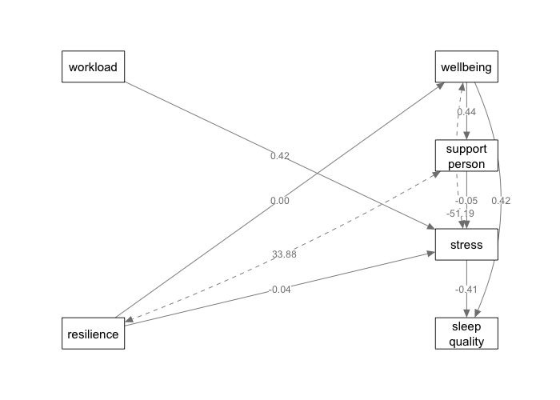

# Path diagram overlap

The previous label-placement check used straight lines between node centres.
It did not account for curved paths, text dimensions, or neighbouring labels.
Small curves could also pass through intermediate nodes in a tree layout.

The renderer now bows paths around intervening nodes and places edge labels
using the actual curve anchors and text dimensions on the output device.
It checks label rectangles against node rectangles and previously placed
labels. Displaced labels receive short leader lines to identify their paths.
Coefficients, labels, arrow directions, and statistical calculations are unchanged.
The existing label-offset option still sets the preferred position before
collision avoidance.

Model B, Control, with full names at the native 700 × 500 output size:

Before:

After:

`tests/testthat/test_diagram_layout.R` renders both workplace models and both
groups through semPlot/qgraph. It checks all four rotations with significance
stars, plus large nodes with residual loops: 20 labelled configurations. None
has a label/node or label/label intersection. Four hidden-label configurations
also render successfully. The tests compare rendered label contents with the
original graph and separately exercise coincident-label placement.

The full repository test suite passes. Visual checks cover Models A and B,
Training as well as Control, and large nodes with residual loops. These checks
use the same renderer and dimensions as jamovi, without a live jamovi window.

Placement searches nearby free space and retains a least-crowded fallback if
a custom graph has insufficient room. Arbitrarily dense graphs can still need
a different layout or abbreviation.
